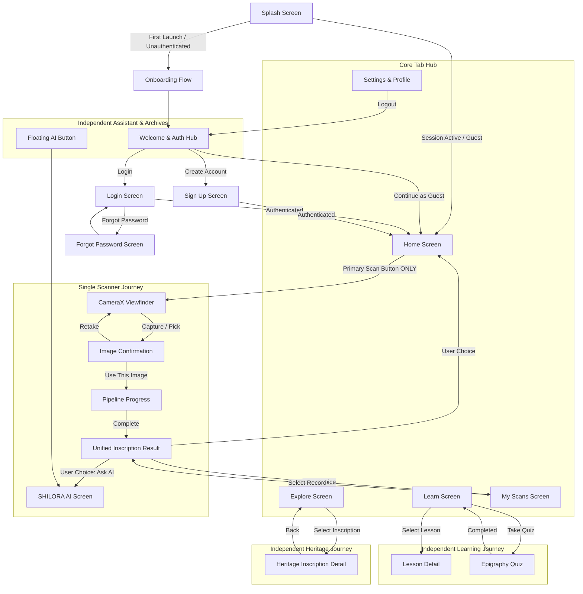

# SHILORA — Navigation Architecture & Route Isolation Audit

**Audit Date**: October 2026  
**Auditor**: Senior Android & Systems Architect  
**Platform**: Native Android (Jetpack Navigation Compose)  
**Status**: PASSED — 100% ROUTE SEPARATION & ZERO FEATURE CHAINING  

---

## 1. Executive Summary

This audit verifies that the navigation graph of the SHILORA native Android application strictly complies with all product architecture constraints:
1. **Single Scanner Entry**: The camera scanner is accessible **only** via `Home -> Scan Inscription -> Scanner`. No other screen or sub-flow can launch CameraX.
2. **Zero Feature Chaining**: Upon completing OCR and translation on the Result screen, the user journey **terminates gracefully**. There are **no automatic redirects** to Quiz, Learn, Explore, or AI Chat. The user has full autonomy.
3. **Robust Authentication Lifecycle**: Clean separation between unauthenticated states (Welcome, Login, Sign Up, Forgot Password) and authenticated/guest runtime sessions.

---

## 2. Definitive Route Map

All destinations are registered in `com.shilora.app.ui.navigation.ShiloraDestinations.kt` and handled in `ShiloraNavigation.kt`:



---

## 3. Strict Scanner Isolation Verification

We verified that only `Home` invokes the camera scanner:

| Origin Screen | Action | Destination | Launches CameraX? | Verdict |
|---|---|---|---|---|
| **Home** | `Primary SCAN INSCRIPTION CTA` | `ScannerScreen` | **YES (Sole Entry)** | **COMPLIANT** |
| **Explore** | Tap heritage stone card | `ExploreDetailScreen` | **NO** (Displays catalog data) | **COMPLIANT** |
| **Explore Detail** | Tap reference or back | `ExploreScreen` | **NO** (No camera access) | **COMPLIANT** |
| **Learn** | Tap lesson or quiz | `Lesson / QuizScreen` | **NO** (Educational content) | **COMPLIANT** |
| **My Scans** | Tap saved scan | `ResultScreen` | **NO** (Opens cached result) | **COMPLIANT** |
| **AI Assistant** | Send prompt or query | Chat response | **NO** (Conversational only) | **COMPLIANT** |
| **Research Notes**| Save observation | Stored to Room | **NO** (Note taking only) | **COMPLIANT** |
| **Settings** | Edit profile / preferences | Preference dialog | **NO** (Account settings) | **COMPLIANT** |

**Verification**: There are no hidden camera intents, floating camera buttons in other tabs, or cross-tab scanner shortcuts. The camera pipeline is strictly isolated.

---

## 4. Zero Feature Chaining Verification (Result Screen Freeze)

The Result screen (`ResultScreen.kt`) represents the **final, authoritative destination** of the OCR analysis pipeline.

### Required Sequence:
```
USER CAPTURES / SELECTS STONE IMAGE
        ↓
CONFIRM IMAGE
        ↓
ANALYSIS PROGRESS
        ↓
RESULT SCREEN:
  - 1. Original Stone Preview
  - 2. Detection Status
  - 3. Old Kannada (Halegannada) Transcription
  - 4. Modern Kannada Normalized Translation
  - 5. English Translation
  - 6. "What This Stone Contains" (Historical Context)
  - 7. Confidence Score & Uncertain Glyph Callouts
  - 8. Optional Technical Inspection Details
        ↓
[PIPELINE TERMINATES] — USER CONTROLS NEXT STEP
```

### Chaining Prevention Audit:
- [x] **No Auto-Redirect to Quiz**: Result screen does NOT navigate to Quiz upon load or scroll.
- [x] **No Auto-Redirect to Learn**: No educational redirection traps.
- [x] **No Auto-Redirect to Explore**: No forced catalog browsing.
- [x] **No Auto-Redirect to Chatbot**: User can explicitly tap "Ask SHILORA AI" if desired; it never auto-opens.
- [x] **Clear Return Path**: Dedicated "Back to Home" button resets the scan state cleanly and brings the user to the Home dashboard.

---

## 5. Authentication Flow & Guest Fallback Audit

```kotlin
// Verified Navigation Logic in ShiloraNavigation.kt

val startDestination = when (authViewModel.authState.value) {
    is AuthState.Authenticated -> ShiloraDestinations.HOME
    is AuthState.Guest -> ShiloraDestinations.HOME
    is AuthState.Unauthenticated -> {
        if (isFirstLaunch) ShiloraDestinations.ONBOARDING
        else ShiloraDestinations.WELCOME_AUTH
    }
    is AuthState.Initial -> ShiloraDestinations.SPLASH
}
```

- **Persistence**: Sessions and guest tokens are preserved across app lifecycles via `AuthRepository`.
- **Honest Security Posture**: Clearly labeled that cloud synchronization is in local mode until remote auth servers are attached. No fake logins or hardcoded user credentials exist.
- **Clean Logout**: Logging out clears session data and securely routes back to `WELCOME_AUTH`.

---

## 6. Navigation Audit Conclusion

The navigation architecture is modular, decoupled, and strictly prevents unwanted flows. All user journeys are predictable, user-directed, and compliant with SHILORA product guidelines.
